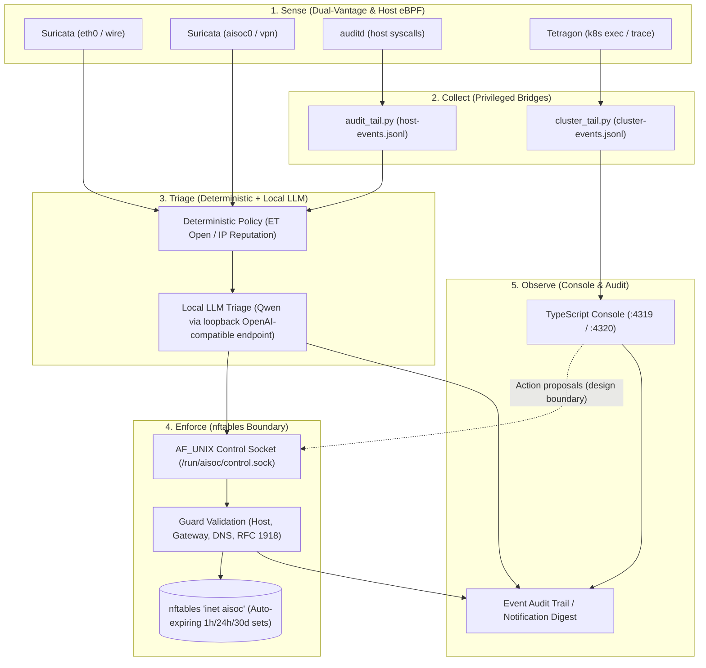

# ai-soc

Home-lab SOC: Suricata and host telemetry triaged by a local LLM, contained with auto-expiring nftables blocks.

[](https://github.com/cmourad/ai-soc/actions/workflows/ci.yml)
[](LICENSE)

## Why this exists

A SIEM/SOAR stack is too heavy for one workstation and a home lab; firewall scripts alone have no context. `ai-soc` pairs network and host telemetry with a local LLM that triages each alert, then limits what that decision can do: every firewall change goes through one enforcer daemon, which checks an allowlist and writes `nftables` blocks that expire on their own. A wrong call costs at most a timed block, not a broken network. Triage runs against a model on loopback, so alerts are not sent to a cloud API by default.


## What it does

- **Multi-vantage sensing**: Captures physical wire traffic and WireGuard tunnel interfaces via Suricata IDS, host syscall activity via `auditd`, and container executions via Kubernetes eBPF (Tetragon).
- **Hierarchical triage engine**: Evaluates telemetry through deterministic reputation policy before escalating ambiguous signals to tiered local LLM models (e.g. Qwen via llama.cpp or Ollama).
- **Safe-by-construction containment**: Enforces IP containment via auto-expiring `nftables` sets (1 hour first strike, escalating on recurrence) so a mistaken block lifts itself without operator intervention.
- **Boundary guardrails**: Before any block, the enforcer rejects loopback, the gateway, DNS resolvers, the host's own addresses, and configured home networks.
- **Incident correlation & MITRE mapping**: Correlates related alerts and process events into structured incident narratives mapped to ATT&CK tactics, techniques, and confidence scores.
- **Real-time analyst console**: Fastify and React web console featuring live alert streaming, incident triage queues, Network Compass flow analysis, and drill simulations.

## Architecture



## Engineering highlights

- **Single nftables writer behind AF_UNIX socket**: Only the Python agent, running as a dedicated user with `CAP_NET_ADMIN` and nothing else, writes nftables. Other components ask over an AF_UNIX socket that checks callers with `SO_PEERCRED`.
- **Policy → fast → full LLM triage tiers**: Deterministic threat intelligence filters obvious noise and known-bad IPs instantly; lightweight fast-tier heuristics batch low-urgency events; high-urgency anomalies escalate to a full LLM model.
- **Auto-expiring escalating blocks**: Block rules are committed to `nftables` sets with native timeouts (1 hour for first strikes, escalating on repeats) so false positives self-heal without manual operator recovery.
- **Guard allowlist validation**: A `Guard` refuses targets that would cut the host off (loopback, gateway, DNS, own addresses, configured home subnets), whatever the model returned.
- **Minimised cluster telemetry**: Kubernetes and host eBPF tailers drop request/response payloads at ingest, forwarding only normalized process trees, namespaces, and security-relevant metadata.
- **Adversary-emulation coverage ledger**: Detections and response playbooks are validated against reproducible attack drills (c2 beaconing, ransomware mass writes, credential dumping) tracked in a structured ATT&CK matrix.

## Run the demo

The web console and simulation pipeline run locally without root privileges, packet capture hardware, or external LLM endpoints:

```sh
cd console && AISOC_DEMO=1 pnpm dev
```

Once running:
- Open `http://127.0.0.1:5319` (Vite dev server; the Fastify API listens on `:4319`).
- The demo initializes with `ingest.source = "seed"`, generating background traffic and simulated adversary activity.
- Interactive drills (C2 beaconing, ransomware staging, credential stuffing) can be triggered from the header to test correlation and response playbooks.

## Tech stack

**Python 3.12**, **TypeScript 5.9**, **Node.js 24**, **Fastify**, **React 19**, **Tailwind CSS**, **nftables**, **Suricata 7**, **auditd**, **Tetragon (eBPF)**, **llama.cpp**.

## Repository layout

| Path | Purpose |
|---|---|
| `agent/` | Python daemon: log ingest, prompt synthesis, local LLM client, Guard filters, and `nftables` manager. |
| `console/server/` | Fastify backend: normalization, detection engine, incident correlation, WebSocket bus, and local storage. |
| `console/ui/` | React SPA: incident dashboard, alert feed, ATT&CK matrix, Network Compass, and drill runner. |
| `console/shared/` | TypeScript domain types, network CIDR helpers, and event contracts. |
| `scripts/` | Host sensors (`audit_tail.py`, `cluster_tail.py`), deployment automation, and tier benchmark evaluators. |
| `systemd/` | Hardened Linux systemd service units with sandboxed security profiles. |
| `k3s/` | Kubernetes audit logging policy configuration and security assessment manifests. |
| `docs/reference/` | Architecture target, threat model, operations manual, estate map, and attack lab ledger. |

## Security

See [SECURITY.md](SECURITY.md) for threat models and privilege tiers. The console service runs with `SupplementaryGroups=docker` to manage containerized sensors; on Linux hosts, access to the Docker socket is root-equivalent, so routing firewall mutations through the enforcer's control socket is a design boundary, not a privilege boundary. A compromised console could reach root through Docker.

## Further reading

- [Architecture Target & Technical Specifications](docs/reference/architecture-target.md)
- [Operations & Configuration Manual](docs/reference/operations.md)
- [Adversary Emulation & Findings Register](docs/reference/attack-lab.md)
- [Estate Map & Telemetry Routing](docs/reference/estate-map.md)
- [Current System Architecture](docs/reference/architecture-current.md)
- [Security Rollout Procedures](docs/reference/security-rollout.md)
- [Network Compass Architecture](docs/reference/network-compass.md)
- [Penetration Testing Plan](docs/reference/pentest-plan.md)
