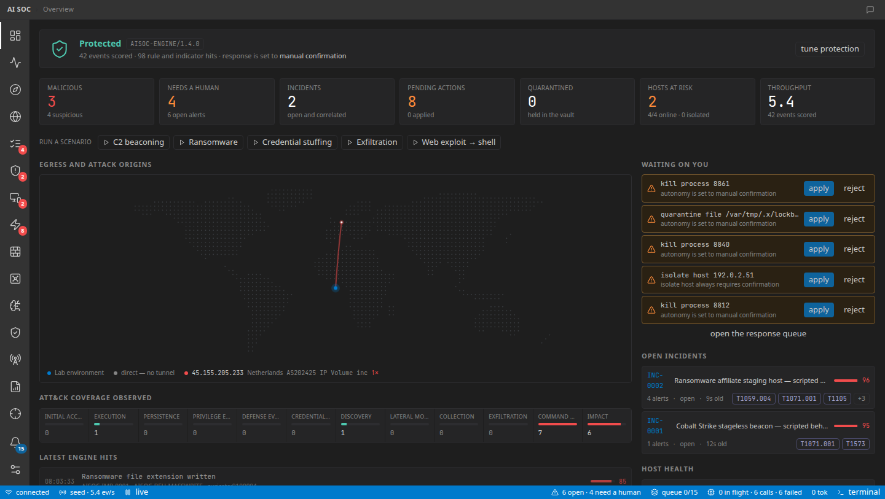
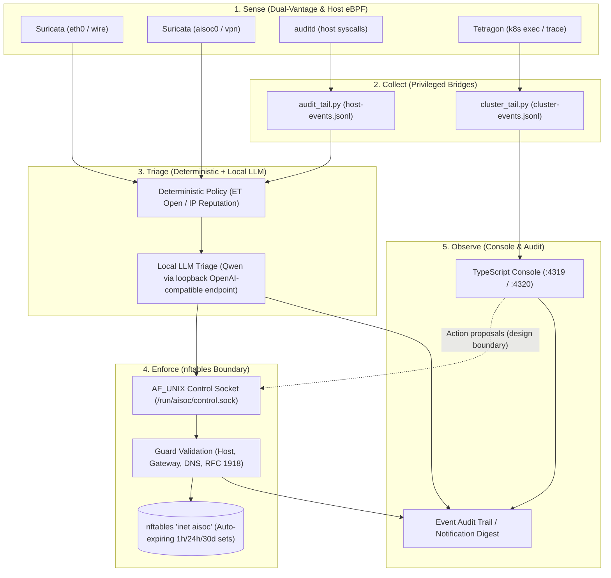

# ai-soc

Autonomous host-level detection, local LLM triage, and self-healing nftables firewall containment.

[](https://github.com/cmourad/ai-soc/actions/workflows/ci.yml)
[](LICENSE)

## Why this exists

Production SIEM and SOAR stacks demand enterprise operational overhead, while basic honeypot and firewall scripts lack contextual awareness. `ai-soc` bridges this gap for workstation and home-lab defense by pairing deep network and host telemetry with offline LLM triage. Enforcement is safe by construction: rather than granting broad automation unconstrained host execution, all firewall mutations route through a dedicated enforcer daemon that commits auto-expiring, escalating `nftables` blocks guarded by non-bypassable network allowlists. The entire pipeline executes locally without transmitting raw telemetry or alerts to external cloud services.



## What it does

- **Multi-vantage sensing**: Captures physical wire traffic and WireGuard tunnel interfaces via Suricata IDS, host syscall activity via `auditd`, and container executions via Kubernetes eBPF (Tetragon).
- **Hierarchical triage engine**: Evaluates telemetry through deterministic reputation policy before escalating ambiguous signals to tiered local LLM models (e.g. Qwen via llama.cpp or Ollama).
- **Safe-by-construction containment**: Enforces IP containment via auto-expiring `nftables` sets (1 hour first strike, escalating on recurrence) to guarantee containment errors recover automatically without operator intervention.
- **Strict boundary guardrails**: Hardened enforcer enforces immutable loopback, gateway, DNS resolver, and RFC 1918 / RFC 8375 home network allowlists before committing any packet filtering changes.
- **Incident correlation & MITRE mapping**: Correlates related alerts and process events into structured incident narratives mapped to ATT&CK tactics, techniques, and confidence scores.
- **Real-time analyst console**: Fastify and React web console featuring live alert streaming, incident triage queues, Network Compass flow analysis, and drill simulations.

## Architecture



## Engineering highlights

- **Single nftables writer behind AF_UNIX socket**: All firewall state modifications are isolated to an unprivileged Python agent with `CAP_NET_ADMIN` communicating across an AF_UNIX socket authenticated via `SO_PEERCRED`.
- **Policy → fast → full LLM triage tiers**: Deterministic threat intelligence filters obvious noise and known-bad IPs instantly; lightweight fast-tier heuristics batch low-urgency events; high-urgency anomalies escalate to a full LLM model.
- **Auto-expiring escalating blocks**: Block rules are committed to `nftables` sets with native timeouts (1 hour for first strikes, escalating on repeats) so false positives self-heal without manual operator recovery.
- **Guard allowlist validation**: Dedicated `Guard` validator asserts destination safety against hardcoded loopback, active gateway, local DNS resolvers, and RFC 1918 / RFC 8375 subnets before execution.
- **Minimised cluster telemetry**: Kubernetes and host eBPF tailers drop request/response payloads at ingest, forwarding only normalized process trees, namespaces, and security-relevant metadata.
- **Adversary-emulation coverage ledger**: Detections and response playbooks are validated against reproducible attack drills (c2 beaconing, ransomware mass writes, credential dumping) tracked in a structured ATT&CK matrix.

## Run the demo

The web console and simulation pipeline run locally without root privileges, packet capture hardware, or external LLM endpoints:

```sh
cd console && AISOC_DEMO=1 pnpm dev
```

Once running:
- Open `http://localhost:5173` (Vite dev server proxying the Fastify API).
- The demo initializes with `ingest.source = "seed"`, generating background traffic and simulated adversary activity.
- Interactive drills (C2 beaconing, ransomware staging, credential stuffing) can be triggered from the header to test correlation and response playbooks.

## Tech stack

**Python 3.12**, **TypeScript 5.9**, **Node.js 24**, **Fastify**, **React 19**, **Tailwind CSS**, **nftables**, **Suricata 7**, **auditd**, **Tetragon (eBPF)**, **llama.cpp**.

## Repository layout

| Path | Purpose |
|---|---|
| `agent/` | Python daemon: log ingest, prompt synthesis, local LLM client, Guard filters, and `nftables` manager. |
| `console/server/` | Fastify backend: normalization, detection engine, incident correlation, WebSocket bus, and local storage. |
| `console/ui/` | React SPA: incident dashboard, alert feed, ATT&CK matrix, Network Compass, and drill runner. |
| `console/shared/` | TypeScript domain types, Zod schemas, network CIDR helpers, and event contracts. |
| `scripts/` | Host sensors (`audit_tail.py`, `cluster_tail.py`), deployment automation, and tier benchmark evaluators. |
| `systemd/` | Hardened Linux systemd service units with sandboxed security profiles. |
| `k3s/` | Kubernetes audit logging policy configuration and security assessment manifests. |
| `docs/reference/` | Architecture target, threat model, operations manual, estate map, and attack lab ledger. |

## Security

See [SECURITY.md](SECURITY.md) for threat models and privilege tiers. The console service runs with `SupplementaryGroups=docker` to manage containerized sensors; on Linux hosts, access to the Docker socket is root-equivalent, so routing firewall mutations through the enforcer's control socket is an intentional architectural isolation boundary rather than a security virtualization barrier.

## Further reading

- [Architecture Target & Technical Specifications](docs/reference/architecture-target.md)
- [Operations & Configuration Manual](docs/reference/operations.md)
- [Adversary Emulation & Findings Register](docs/reference/attack-lab.md)
- [Estate Map & Telemetry Routing](docs/reference/estate-map.md)
- [Current System Architecture](docs/reference/architecture-current.md)
- [Security Rollout Procedures](docs/reference/security-rollout.md)
- [Network Compass Architecture](docs/reference/network-compass.md)
- [Penetration Testing Plan](docs/reference/pentest-plan.md)
