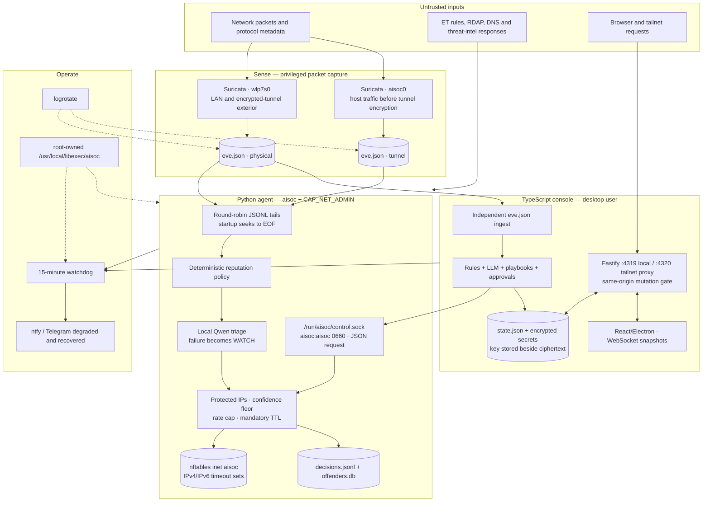

Technical reference: As-built security architecture and risk assessment.

# aisoc — current security architecture

**As built and partially live-verified: 2026-08-07**

This document describes the system that exists now, including its trust boundaries,
security controls, and residual risk. Repository facts were verified against source and
unit files. Live facts called out below were verified against the running host. A control
being present in source does not imply that every external container or host setting has
already been reconciled.

## Executive assessment

aisoc has strong foundations for a single-user, single-host defensive appliance: two
useful network vantage points, local-only inference, deterministic policy before LLM
judgment, expiring firewall actions, a root-owned deployment copy, same-origin request
checks, and active self-monitoring.

Its dominant risk is currently **privilege-boundary collapse around the console**. The
console runs user-writable TypeScript and dependencies as an unprivileged host operator account (`operator`), while that account can
run multiple root-equivalent commands without a password (`apt`, `apt-get`, `systemctl`,
`cp`, and `rm`, among others). A malicious dependency, successful console exploit, or
local process running as that user can therefore become root. Removing this path is more
urgent than adding features or increasing triage throughput.

The second architectural risk is split authority. The Python agent and TypeScript console
both ingest and decide. They now share one nftables writer—the agent's Unix control
socket—so the earlier “two trigger fingers” problem is partly remediated, but policy,
state, audit, and action lifecycle still have two owners.

## Scope and security objectives

Protected assets, in priority order:

1. Host integrity and the operator's administrative credentials.
2. Availability of networking, DNS, VPN, and the operator's recovery path.
3. Integrity of firewall policy and response actions.
4. Confidentiality of API keys, VPN material, alerts, and browsing metadata.
5. Completeness and integrity of evidence, decisions, and audit records.
6. Availability and freshness of sensing, triage, notification, and recovery.

Expected adversaries include hostile Internet endpoints, malicious content embedded in
network telemetry, compromised threat-intelligence services, a hostile website visited by
the operator, vulnerable npm/container dependencies, and malware executing as the desktop
user. Root or physical compromise is outside the prevention boundary, but should remain
detectable and recoverable where practical.

## As-built diagram

## Trust boundaries and data flows

| Boundary | Current authorization | Security consequence |
|---|---|---|
| Packet capture → JSONL | Filesystem access to Suricata output | Records are attacker-influenced and unauthenticated; every field must be treated as hostile data. |
| JSONL → agent/console | Independent file tails and local parsing | The two consumers can disagree, skip different data, and cannot prove a shared processing position. |
| Agent → local LLM | Loopback HTTP, no application authentication | LAN exposure is avoided if the bind remains loopback; any local process can invoke or exhaust the model. |
| Console → enforcer | Unix socket mode `0660`, group `aisoc` | Socket possession authorizes all operations. The server does not yet verify `SO_PEERCRED`; the supplied actor is not trustworthy evidence. |
| Browser → local API | Loopback plus Origin/Fetch-Metadata checks | Cross-site browser writes are reduced, but any local process can invoke the unauthenticated API as `analyst`. |
| Tailnet → remote API | Tailscale Serve identity header plus login allowlist | Safe only if port 4320 remains loopback-only and only Tailscale can inject the trusted header. There is no independent app session or role model. |
| Console → privileged host operations | Passwordless sudo policy on operator account | Compromise of the console service account is effectively root compromise. |
| State → disk | File modes and AES-GCM envelope | Secrets are protected from casual reading only; the decryption key is adjacent and available to the same compromised account. |

## Security controls that are working

- Suricata observes both the physical NIC and the WireGuard clear-text interface;
  thresholding removes known high-volume noise before expensive triage.
- Deterministic reputation policy runs before LLM triage. LLM failure or malformed output
  produces `WATCH`, not an automatic block.
- The enforcement guard protects host, gateway, resolver, loopback, multicast, link-local,
  Docker bridge, and allowlisted addresses. Blocks have bounded lifetimes and a global
  hourly cap.
- The console no longer invokes `nft` directly. Block and unblock requests use the agent's
  control socket, and the nftables view is read from the agent rather than cached.
- Privileged systemd units execute root-owned deployed files under
  `/usr/local/libexec/aisoc`; they do not execute scripts from the writable repository.
- The agent runs as `aisoc` with `CAP_NET_ADMIN`, a capability bounding set, no-new-
  privileges, a read-only filesystem view, and systemd sandboxing.
- Mutating browser routes reject cross-site/same-site Fetch Metadata and hostile Origin
  values. The remote listener requires an allowlisted Tailscale login.
- State replacement is atomic; in-memory collections have bounds; health probes are
  constant-time; logs rotate; the watchdog and notification recovery loop are active.

## Material findings and residual risk

Priority reflects realistic single-host impact, not the number of missing controls.

| ID | Priority | Finding | Impact and required disposition |
|---|---|---|---|
| CUR-01 | **Critical** | Operator account had root-equivalent passwordless sudo commands; the console runs writable source and npm dependencies as that account. | A console/dependency compromise can replace units, packages, or root files. Remove broad sudo rules immediately; split VPN/system actions into narrow helpers; run a compiled, root-owned console as a dedicated unprivileged user. |
| CUR-02 | **High** | Local API authorization equates loopback with a trusted analyst. | Malware or any process under the desktop account can change settings, secrets, approvals, VPN state, and firewall state. Require an application session and explicit roles even on loopback; bind the desktop to a protected IPC or one-time credential. |
| CUR-03 | **High** | The enforcer socket relies on group mode only and accepts caller-supplied `by`; no `SO_PEERCRED`, request identity binding, replay/idempotency key, or operation-level authorization exists. | Any member of the socket group can block, unblock, and enumerate policy while forging audit attribution. Verify peer PID/UID/GID, allow exact service identities, derive the actor server-side, frame requests, cap concurrency, and make action IDs idempotent. |
| CUR-04 | **High** | Two ingestion/decision pipelines and multiple state stores remain. | Conflicting verdicts, duplicate actions, data loss, and irreconcilable audit timelines are possible. Converge on one normalized event log and one policy engine; keep the enforcer policy-independent and narrow. |
| CUR-05 | **High** | File tails seek to EOF at startup and cursor state is not durably committed with event processing. | Alerts produced while a service is down can be silently missed; rotation races can lose records. Use a device/inode/offset cursor committed transactionally with normalized event insertion and deduplicate by stable event ID. |
| CUR-06 | **High** | Audit records are mutable JSON/state owned by the same principals that produce them. | A compromised agent or console can alter or erase evidence. Record enforcement decisions independently, hash-chain audit entries, ship signed checkpoints off the host, and test restoration. |
| CUR-07 | **High** | Secret ciphertext and key share the same directory and account; `state.json` is mode `0644`. | Account compromise exposes secrets and sensitive telemetry. Move keys to systemd credentials or a hardware-backed secret; set all state to `0600`; minimize stored secrets and rotate after migration. |
| CUR-08 | **High** | Host audit ingestion is disabled because auditd is absent. | Network controls cannot detect many local compromise and privilege-escalation paths. Deploy the host sensor with narrowly scoped read access, or explicitly accept and monitor the blind spot. |
| CUR-09 | **Medium** | API hardening lacks a complete Host allowlist, app session, per-route authorization, rate limits, request-size policy, CSP, and other response headers. | DNS rebinding, local request abuse, resource exhaustion, and renderer compromise have a larger blast radius than necessary. Apply the target HTTP security profile and negative tests. |
| CUR-10 | **Medium** | Suricata uses a mutable image tag and broad capture capabilities; the console runs through `tsx` from writable `node_modules`. | Supply-chain drift or package compromise can alter trusted code. Pin image digests, generate an SBOM, scan/sign release artifacts, and execute compiled immutable output. |
| CUR-11 | **Medium** | LLM and enrichment calls have no explicit egress policy or per-provider privacy classification. | Tool output can be poisoned; telemetry and API keys may leak to configured providers; local services can be exhausted. Pin destinations, validate tool arguments/results, enforce budgets and circuit breakers, and document which data may leave the host. |
| CUR-12 | **Medium** | Backup, restore, disaster recovery, and nftables reconciliation are not demonstrated. | Disk loss, database corruption, or rule drift may destroy evidence or leave a false sense of containment. Define RPO/RTO, encrypted off-host backups, restore drills, and desired-vs-actual firewall reconciliation. |

## Live verification snapshot

Verified on 2026-08-07:

- `aisoc-agent.service`, `aisoc-console.service`, and `aisoc-watchdog.timer` were active.
- The agent ran as `aisoc`; the console ran as `operator` from repository TypeScript via
  `tsx`.
- `/usr/local/libexec/aisoc/agent/aisoc.py` was `root:root` and not user-writable.
- `/run/aisoc/control.sock` was listening as `aisoc:aisoc` with mode `0660`; `operator` was
  a member of the `aisoc` group.
- `secret.key` and `secrets.enc.json` were `0600`; `state.json` was `0644`.
- The effective sudo policy included broad root-capable `NOPASSWD` commands, not only
  `cp` and `rm`.

The live nftables contents could not be inspected without root, so rule presence and
timeouts are supported by source/deployment behavior rather than that live check.

## Security posture summary

The system is suitable for continued development and monitored simulation, but **full
autonomous response should remain disabled** until CUR-01 through CUR-06 are closed and
their acceptance tests pass. The target architecture defines those tests and the order in
which to close the risks.

## Verified worktree hardening awaiting activation

The 2026-08-07 worktree now contains the first implementation tranche from the target
architecture: peer-credential enforcement, framed/idempotent control requests, dedicated
`aisoc-core` production identity, immutable bundled releases, session/CSRF/Host/rate/header
API controls, private atomic state writes, a pinned Suricata digest, and restored Electron
sandboxing. The test and build gates pass.

These controls are not described as live above because `sudo scripts/deploy.sh` requires
interactive administrator authentication on this host. Until that command and the two
service restarts in `security-rollout.md` complete, the live snapshot and risk ratings in
this document remain authoritative.
