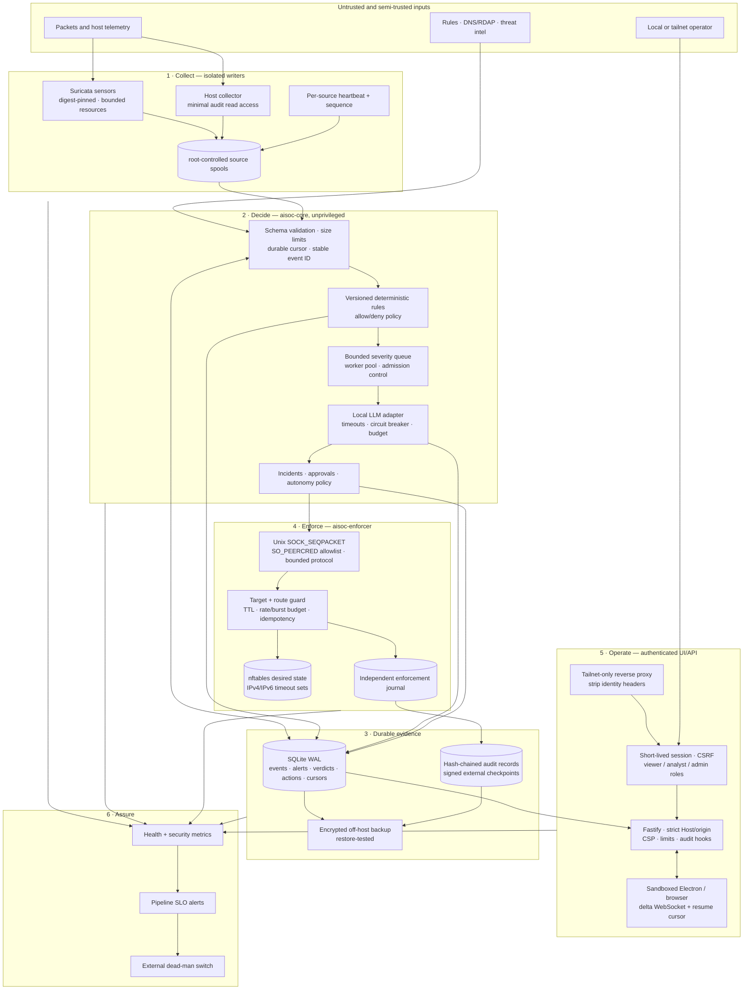

Technical reference: Target architecture specifications and invariants.

# aisoc — target security architecture

**Target state: single-host, local-first defensive appliance**

## Outcome

One unprivileged decision service owns normalized events, detection, triage, approvals,
and case state. One minimal privileged enforcer owns nftables. Every action is authorized,
bounded, attributable, idempotent, reversible, and independently auditable. Loss of a
sensor, model, queue, database, notifier, or enforcement path becomes visible within a
defined time.

The design intentionally remains small: one host, SQLite, Unix sockets, systemd, and no
general-purpose message broker. Complexity is spent on explicit trust boundaries and
recovery rather than infrastructure.

## Mandatory security invariants

These are release gates, not aspirations:

1. **Untrusted text never becomes authority.** Packets, protocol metadata, DNS/RDAP,
   threat-intelligence results, filenames, prompts, and model output are data only.
2. **The LLM cannot directly execute.** It can recommend `BLOCK`, `WATCH`, or `IGNORE`;
   deterministic policy and autonomy rules decide whether an action may be proposed.
3. **Only the enforcer changes host controls.** The core, UI, model, collectors, and npm
   dependencies have no `CAP_NET_ADMIN`, root shell, or general sudo path.
4. **The enforcer distrusts its caller.** It authenticates the OS peer, validates the
   operation and target, applies independent safety policy, requires an expiry, enforces
   budgets, and records both requests and refusals.
5. **No identity is inferred from network location alone.** Loopback, tailnet membership,
   and browser same-origin checks are transport controls, not user authorization.
6. **Processing is durable and idempotent.** An event is either committed with its cursor
   or safely replayed; an action ID cannot execute twice.
7. **Evidence compromise is detectable.** Operational state may be mutable; security audit
   records are append-only, hash-chained, and externally checkpointed.
8. **Degradation never silently increases autonomy.** Missing models, stale rules, full
   queues, broken storage, or uncertain identity hold automated action and page the
   operator.
9. **Every block expires.** No automated action may create a permanent network denial.
10. **The operator retains a recovery path.** Gateway, DNS, VPN endpoints, management
    access, and break-glass procedures are protected and tested.

## Threat model

### In scope

- Remote attackers generating malicious or adversarial network telemetry.
- Prompt injection and parser abuse through attacker-controlled protocol fields.
- Poisoned or unavailable rule, RDAP, DNS, model, and threat-intelligence dependencies.
- Cross-site requests, DNS rebinding, malicious WebSocket clients, and stolen tailnet
  sessions.
- A vulnerable or malicious application/container/npm dependency.
- Malware executing as the interactive desktop user or another unprivileged local user.
- Resource exhaustion, log flooding, disk pressure, service crashes, rotation races, and
  partial writes.
- Accidental operator actions, policy mistakes, and compromised automation.
- Theft or corruption of local state and backups.

### Assumptions and limits

- The kernel, systemd, and hardware root of trust are trusted. Kernel/root compromise is a
  detection and recovery scenario, not something this process layout can contain.
- Physical console access and firmware attacks require host controls outside this project.
- Malware running as the interactive operator may be able to steal that operator's active
  UI session. The architecture must still prevent that compromise from becoming a service
  identity, direct enforcer access, or root; sensitive actions use recent re-authentication
  when protection from a stolen session is required.
- Tailscale authenticates tailnet peers, but aisoc still performs its own authorization.
- Public Internet exposure is prohibited. Remote access is tailnet-only; Funnel is off.

## Target diagram

## Component security design

### 1. Collectors

- Keep separate sensors for `wlp7s0` and `aisoc0`; a missing VPN interface must not take
  down physical-interface coverage.
- Pin container images by digest. Drop every capability not required by the selected
  capture mode, use a read-only root filesystem where supported, bound memory/PIDs/logs,
  and prohibit host control sockets inside the container.
- Write source files into collector-owned spool directories. Core receives read-only
  access; the interactive user cannot rewrite evidence.
- Normalize neither trust nor meaning in the collector. It emits a source identifier,
  source sequence/offset, receive timestamp, schema version, and bounded raw payload.
- The host collector runs under a dedicated identity with only the audit-read mechanism
  supported by the host. It never runs the decision engine or an enrichment client.
- A heartbeat is an event. “No alerts” and “collector dead” must be distinguishable.

### 2. Core decision service

Run compiled, root-owned JavaScript as `aisoc-core`, with no supplementary interactive
groups, capabilities, sudo, shell-based execution, or write access to code and lockfiles.
Use systemd sandboxing comparable to the enforcer, with writable paths limited to its
state directory and access to only required address families and destinations.

The core is the sole owner of:

- normalized event ingestion and cursor commits;
- deterministic detections and policy versioning;
- bounded triage scheduling and LLM calls;
- incidents, approvals, action proposals, and UI state;
- the application database and derived read models.

The old Python triage loop is retired after replay parity. It must not remain as a hidden
fallback decision path.

### 3. LLM and enrichment boundary

- Construct prompts from a fixed system template plus typed JSON. Delimit and length-cap
  all observed data. Never interpolate wire content into system/developer instructions.
- Validate model output against a strict schema; reject unknown keys, non-finite numbers,
  overlong reasons, and unsupported verdicts. A rejected/timeout response becomes
  `WATCH` and cannot increase autonomy.
- Deterministic detections and allow/deny policy are authoritative. Confidence is an
  advisory signal, not authentication or proof.
- A severity-1 `IGNORE`, disagreement between high-confidence deterministic evidence and
  the model, or detected instruction-like input requires human review.
- Tool calls are read-only, explicitly allowlisted, argument-schema validated, destination
  pinned, response-size limited, timeout/circuit-breaker protected, and recorded. Do not
  permit arbitrary URLs, DNS rebinding targets, redirects to private ranges, or shell
  execution.
- Apply per-minute and per-day inference budgets. Queue overflow creates a persisted
  `WATCH/degraded` result plus a counter; it never discards without evidence.
- Maintain a versioned adversarial evaluation set. Prompt/model/rule changes cannot deploy
  unless they preserve zero false-ignore results for the critical set and meet documented
  latency/capacity thresholds.

### 4. Durable event and state model

Use SQLite WAL as the application's transactional source of truth. Only `aisoc-core`
writes the main database; UI and jobs go through the core API instead of opening it.

Minimum logical records:

- `sources`, `source_cursors`, `events`, and `ingest_failures`;
- `detections`, `llm_calls`, `verdicts`, and `policy_versions`;
- `incidents`, `approvals`, `actions`, `action_attempts`, and `enforcement_results`;
- `audit_entries`, `audit_checkpoints`, and retention/backup metadata.

Ingestion transaction:

1. Read one bounded record and validate its versioned schema.
2. Derive a stable event ID from source identity plus immutable source position/content.
3. Insert the event with `ON CONFLICT DO NOTHING`.
4. Advance the device/inode/generation/offset cursor in the same transaction.
5. Acknowledge only after commit. Rotation preserves unread old-file data before moving to
   the new generation.

Use foreign keys, integrity checks, prepared statements, busy timeouts, explicit schema
migrations, and startup refusal on unknown future schema versions. Retention deletes only
after a verified backup/checkpoint and preserves aggregate security evidence.

Classify raw packet metadata, user/device identifiers, prompts, and exported cases as
sensitive security telemetry. Minimize captured fields, default raw-event retention to a
documented short period, encrypt the host volume, encrypt every off-host copy, and record
exports as privileged audit events. Database encryption alone is not a substitute for
service isolation because the running core must be able to read its data.

SQLite provides durability, not trustworthy audit by itself. Audit entries form a hash
chain over canonical fields and the previous hash. A hardware- or system-credential-held
key signs periodic checkpoints that are pushed to an independent destination. The
enforcer keeps a small separate journal so compromise of the core cannot erase what the
privileged boundary actually accepted or refused.

### 5. Privileged enforcer

The enforcer is a small, dependency-light service running as `aisoc-enforcer` with only
`CAP_NET_ADMIN`. It owns the `inet aisoc` table and no other process invokes `nft`,
`wg-quick`, `systemctl`, or a privileged shell.

Protocol requirements:

- Prefer Unix `SOCK_SEQPACKET`, or a length-prefixed stream protocol; never assume one
  `recv()` equals one request.
- Enforce a small maximum frame, timeout, connection limit, enum-only operation names, and
  strict request/response schemas.
- Read `SO_PEERCRED` and authorize exact UID/GID plus expected executable/cgroup when
  available. Derive the actor from the peer; ignore caller-asserted identity.
- Require a random action ID, policy version, target, reason code, and requested TTL.
  Persist the result by action ID before reply so retries are idempotent.
- Separate permissions for `status`, `block`, `unblock`, and future `isolate`. Unblock is a
  security-sensitive mutation and must be attributed and authorized.

Independent guard policy:

- Parse IPs canonically; support IPv4 and IPv6 without regex approximations.
- Refuse host addresses, loopback, link-local, multicast, unspecified/broadcast, gateway,
  resolvers, declared LANs, container networks, active VPN/tailnet endpoints, management
  paths, and versioned allowlist entries.
- Resolve host route facts at execution time and fail closed if critical facts cannot be
  read. Protect both source and destination implications.
- Enforce mandatory TTL bounds, per-target cooldown, global and subnet burst limits, and a
  maximum concurrently blocked population.
- Apply nftables updates atomically, verify desired versus actual state, detect foreign
  modifications, and reconcile on restart. Never flush unrelated tables.
- Return a structured refusal code and record request peer, action ID, policy version,
  canonical target, result, expiry, and actual nftables handle/state.

VPN connect/disconnect and host isolation are separate privileged capabilities. Implement
them as distinct narrow helpers with their own schemas and peer authorization; do not
expand the firewall enforcer into a general command runner.

### 6. Identity, API, and UI

- The local desktop receives a one-time bootstrap secret through a protected file
  descriptor/Unix socket and exchanges it for a short-lived, HttpOnly, Secure (where TLS
  is used), SameSite=Strict session. Do not store bearer tokens in renderer local storage.
- Remote traffic reaches a dedicated loopback listener only through Tailscale Serve. The
  proxy must remove inbound identity headers before inserting authenticated identity and
  authenticate the proxy-to-app hop with a private Unix endpoint, OS policy, or a rotated
  service credential. The app maps that identity to an explicit `viewer`, `analyst`, or
  `admin` role and issues its own short-lived session.
- Require CSRF tokens on every state-changing browser route in addition to strict
  Origin/Fetch-Metadata checks. Validate `Host` against explicit local and tailnet names;
  never construct trust decisions from an arbitrary Host header.
- Default remote users to read-only. Firewall changes, secret changes, rule changes,
  autonomy changes, VPN operations, exports, and audit administration require explicit
  permissions; high-impact changes require recent re-authentication.
- Rate-limit by session and operation, cap request bodies and exported result sizes,
  validate every route input, and use consistent non-sensitive errors.
- Set a restrictive CSP, `frame-ancestors 'none'`, `object-src 'none'`, nosniff, a strict
  referrer policy, and an explicit permissions policy. Disable caching for sensitive API
  responses.
- WebSockets authenticate at handshake, enforce Origin and Host, cap frames/queues, send
  deltas with monotonically increasing cursors, and resume without full-state snapshots.
- Keep Electron sandboxing, context isolation, and no Node integration. Allow navigation
  only to the configured local origin; validate external-link schemes before opening.

### 7. Secrets and cryptographic material

- Remove the key-next-to-ciphertext design. Supply runtime secrets with systemd
  `LoadCredentialEncrypted=`, a TPM-bound key, or an age-encrypted bundle whose identity
  is not readable by the service account at rest.
- Give each service only the credentials it needs. Separate notification, threat-intel,
  VPN, audit-signing, and backup credentials; never expose them to the renderer or logs.
- Use atomic `0600` files under dedicated state directories for sensitive local data.
  Zeroize transient buffers where the runtime permits and avoid long-lived global copies.
- Document rotation, revocation, backup, and recovery for every credential. Rotate all
  credentials after migration from the current storage model.
- Encryption at rest does not defend against compromise of a running service that can
  legitimately decrypt its credentials. Least privilege and service separation remain the
  primary controls.

### 8. Build, deployment, and host boundary

- Remove broad `NOPASSWD` sudo entries before enabling autonomous enforcement. A desktop
  user must not control package installation, unit definitions, arbitrary copies/removals,
  or unrestricted service management.
- Build in an unprivileged workspace; test; generate an SBOM; scan dependencies, secrets,
  and container images; then publish versioned artifacts into root-owned `/opt/aisoc`.
- Lock dependencies, pin container digests, record source revision/toolchain, and produce a
  release manifest with hashes. Prefer signed tags/artifacts and verify before install.
- Production units execute compiled output, never `tsx`, a package-manager shim, repository
  source, or writable `node_modules`.
- Deployment is atomic (`releases/<id>` plus a root-owned current symlink), refuses dirty or
  unverified artifacts by default, retains a known-good rollback, and runs post-deploy
  health/security checks.
- Bind Loki, Grafana, model servers, metrics, exporters, and databases to loopback or an
  authenticated management network. Disable anonymous admin, rotate default credentials,
  and authenticate Loki writes so evidence cannot be forged.

## Failure behavior

| Failure | Required behavior | Alert deadline |
|---|---|---|
| One collector stops or heartbeat is stale | Preserve other sources; mark coverage degraded; never report “quiet” as healthy | 15 min |
| Ingest cursor lag exceeds 60 s | Continue durable catch-up; hold autonomous actions if evidence ordering is uncertain | 5 min |
| Invalid/oversized event | Quarantine bounded metadata and reason; advance only according to explicit poison-record policy | 5 min if rate exceeds threshold |
| SQLite unavailable/corrupt/read-only | Stop accepting mutating API work and autonomous actions; preserve source spool; page | 5 min |
| Triage queue full | Persist `WATCH/degraded`; shed by documented severity policy; never silently drop severity 1 | 1 min |
| LLM slow, malformed, or unavailable | Circuit-break; deterministic detections continue; LLM-dependent results become WATCH | 5 min |
| Enforcer unavailable or refuses | Action remains failed/pending, never “applied”; expose exact refusal; page on sustained failure | 5 min |
| nftables differs from desired state | Do not flush foreign rules; reconcile owned objects or hold and page on ambiguity | 5 min |
| Notification path fails | Retry with backoff and signal through independent dead-man channel | 15 min |
| Rules exceed freshness objective | Mark detection coverage degraded and hold policies dependent on stale feeds | 48 h maximum age |
| Disk exceeds thresholds | Stop nonessential enrichment/export, accelerate safe retention, preserve audit/action writes | warn 70%, page 80%, critical 90% |
| Backup/checkpoint absent | Page; do not claim recoverability or tamper evidence | 24 h |

## Observability and assurance

Expose low-cardinality metrics without alert contents, IPs, secrets, or user-controlled
labels:

- source heartbeat age, cursor lag, parse failures, duplicate count, and spool depth;
- queue depth/capacity, triage admission/shed count, verdict totals by tier, and latency;
- LLM failures, circuit state, token/time budget, and evaluation model/prompt version;
- action requests/results/refusals, active blocks, expiry lag, and reconciliation drift;
- database WAL size/integrity result, disk usage, backup age, checkpoint age, and restore age;
- API authentication failures, authorization refusals, CSRF/Host/Origin refusals, and
  rate-limit events.

The external dead-man monitor must expect a signed heartbeat. Monitoring hosted only on
the protected machine cannot prove that the machine is alive. Alert messages contain IDs
and summaries, not raw packet fields, secrets, or full prompts.

## Delivery plan and acceptance gates

### Phase 0 — close root-equivalent paths

- Replace broad sudo rules with no general console sudo capability.
- Disable real autonomous execution until the boundary tests below pass.
- Bind or firewall remaining management services; remove anonymous/default credentials.
- Set sensitive state modes to `0600` and rotate exposed/default secrets.

**Gate:** compromising `aisoc-core` or the renderer cannot invoke package management,
systemd mutation, arbitrary file replacement, VPN tools, or nftables except through a
documented helper protocol.

### Phase 1 — harden the existing enforcement choke point

- Add peer-credential authorization, framed schemas, server-derived identity, operation
  permissions, idempotency, independent logging, and concurrency limits.
- Add route-aware protected targets, IPv6 parity, subnet/global budgets, atomic nftables
  reconciliation, and enforcement security tests.

**Gate:** tests prove unauthorized UID/GID, forged actor, malformed/partial/oversized
frames, duplicate action IDs, protected targets, excessive TTLs, rate bursts, and enforcer
restart cannot cause an unsafe or duplicate action.

### Phase 2 — one schema, one transactional store, one brain

- Define versioned schemas and generated types/validators.
- Implement SQLite migrations, WAL, transactional cursors, stable IDs, replay, retention,
  integrity checks, and backup metadata.
- Move console state and action lifecycle into the store; replay historical cases to prove
  decision parity; retire the Python decision loop.

**Gate:** forced crashes at every ingest/action boundary produce neither lost acknowledged
events nor duplicate enforcement. Rotation and 24-hour outage catch-up tests pass.

### Phase 3 — authenticated access and immutable runtime

- Run compiled root-owned artifacts as dedicated users.
- Add local and remote sessions, CSRF tokens, roles, strict Host/origin policy, headers,
  request/rate limits, and WebSocket resume.
- Move VPN and any future host action into separate narrow helpers.

**Gate:** browser security tests cover cross-site forms/fetch, DNS rebinding Host values,
WebSocket hijacking, forged Tailscale headers, role escalation, session expiry, replay, and
renderer navigation. A local process without the bootstrap/session secret is rejected at
the API, and compromise of an interactive-user session still cannot authenticate as
`aisoc-core` to a privileged helper.

### Phase 4 — bounded triage and adversarial evaluation

- Add the priority worker pool, admission control, budgets, tool boundary, and circuit
  breaker.
- Establish golden replay, prompt-injection, parser fuzz, and policy-regression suites.

**Gate:** severity-1 events are never silently shed; queue overload and model outage meet
the failure table; the critical evaluation set has zero false ignores before promotion.

### Phase 5 — tamper evidence and recovery

- Add hash-chained audit, independent signed checkpoints, encrypted off-host backups,
  release manifests, and restore/rollback automation.
- Exercise database loss, secret loss, nftables drift, bad release rollback, notifier
  outage, and complete-host recovery.

**Gate:** demonstrated **RPO ≤ 24 hours** and **RTO ≤ 4 hours** for a single-user desktop;
audit deletion/modification is detected at the next checkpoint; the latest known-good
release and backup restore successfully on a clean host.

## Security test matrix

At minimum, CI and release verification cover:

- schema property/fuzz tests for Suricata, host, LLM, tool, API, and socket inputs;
- prompt-injection cases in every attacker-controlled string field;
- protected-address and route-change tests for IPv4 and IPv6;
- action authorization, approval races, idempotency, expiry, rollback, and rate budgets;
- file rotation, truncation, partial lines, corrupt records, restart, disk-full, and WAL
  recovery;
- CSRF, CORS, Host/DNS rebinding, WebSocket Origin, session fixation/expiry, and RBAC;
- dependency/license/secret scans, image-digest verification, SBOM creation, artifact hash
  verification, and clean production install;
- backup restore and audit-chain/checkpoint verification.

Security-sensitive pure logic should have branch-focused unit tests. Cross-boundary
properties require integration tests using real Unix peer credentials, nftables in an
isolated namespace, process crashes, and a real browser—not mocks alone.

## Explicitly rejected complexity

Kubernetes, a service mesh, Kafka, and a multi-node database remain out of scope. They do
not reduce the dominant risks on one desktop. SQLite WAL, collector spools, bounded queues,
Unix peer credentials, narrow privileged helpers, immutable releases, and external backups
provide the required security and reliability properties with a smaller attack and
operational surface.
