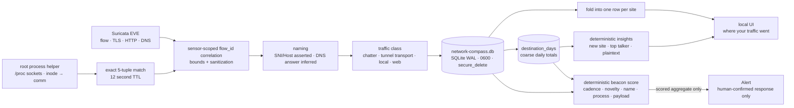

Technical reference: Private network usage ledger, telemetry processing, and privacy bounds.

# Private Network Compass

**Implemented: 2026-08-08**

## Purpose and non-goals

Network Compass explains completed network flows and may suggest adjacent,
non-sensitive topics after repeated local evidence. It is not an activity
monitor, employee-monitoring system, browser-history replacement, advertising
profile, or direct enforcement input. Ordinary flows never enter alert triage.
A narrowly scoped beacon bridge may open an Alert from deterministic aggregate
features, but its origin permanently bars every automatic response. A Curiosity
Card can never trigger a firewall or host action.

## Data flow

The physical and VPN EVE streams may both be tailed using comma-separated
paths. Their `in_iface` values keep the two vantage points attributable. Flow
IDs are correlated only within the running collector's bounded metadata cache,
keyed by sensor so the two streams cannot cross-attribute a name.

The root-only process helper samples `/proc/net/{tcp,tcp6,udp,udp6}` and the
`/proc/*/fd` socket inode map twice per second. The unprivileged console asks
for an exact protocol, local address/port and remote address/port match through
the peer-authenticated agent control socket. Matches expire after 12 seconds;
ambiguous ownership, unconnected UDP sockets, old replay records and missed
short-lived connections stay `unknown`. Only the kernel `comm` name crosses the
boundary or enters the ledger. Command lines, executable paths, PIDs and users
do not.

DNS answers populate a bounded, six-hour address→name cache used to label
otherwise-anonymous flows. Such names are marked `inferred`, never `asserted`,
because shared hosting and CDNs make the mapping approximate. A DNS packet
itself is attributed to the resolver it was sent to, not to the name it asked
about: recording the query as a destination both misattributed the flow and
wrote a browsing history into the ledger.

When the tunnel is up, both EVE streams see the same activity — once encrypted
to the exit node and once decrypted to real destinations. The exit endpoint is
therefore classed as transport, keeping it out of the headline totals it would
otherwise double.

## Security and privacy invariants

1. Compass is explicit opt-in and paused independently of security sensing.
2. Only completed flow summaries are persisted. No packet body, full URL,
   search query, user-agent, command line, executable path, PID, user, or model
   prompt is stored. Process attribution stores the kernel `comm` name only.
3. Domain strings are length bounded, rejected rather than repaired when they
   contain illegal characters, capped at four labels, and treated as hostile
   data. Silent repair previously turned `foo bar.com` into the unrelated real
   domain `foobar.com`.
4. The taxonomy is deterministic and contains only broad non-sensitive
   categories. Unknown remains an honest outcome.
5. Insights are statements of fact about the retained window that the operator
   can verify from the table beneath them. They are not inferences about the
   person, and novelty is only claimed once the daily totals remember an
   earlier day — otherwise every site looks new on the first run.
6. Raw retention defaults to 24 hours, is bounded to seven days, and also has a
   25,000-record cap. Expiry is enforced in memory and SQLite.
7. Coarse per-destination daily totals (`destination_days`) outlive the raw
   flows by a separately configured `historyDays`, default 30. Named sites use
   their registrable domain; unresolved destinations use an `ip:` key so beacon
   novelty is measured rather than assumed. These rows retain only day, byte
   totals and connection count—no sub-day timing, port or process. Setting
   `historyDays` to zero disables that memory and novelty-gated detection.
8. The database disables extension loading, uses prepared statements, strict
   tables, WAL, `secure_delete`, and mode `0600` inside the mode `0700` data
   directory. Without `secure_delete` the minutely retention prune left expired
   metadata readable in freed pages, making the retention setting cosmetic.
9. The remote listener receives no snapshots, live flows, summaries, feedback
   endpoints, Compass setting mutations, or exclusion values. Compass audit
   entries are withheld from both the live stream and the initial snapshot,
   which previously disagreed.
10. Forgetting data transactionally deletes flows, daily totals and insight
    feedback, then checkpoints the WAL and VACUUMs so the bytes are gone rather
    than merely unlinked.
11. The first-tier model may review Compass, under `aiReviewEnabled`, which is
    off by default and never fires on a timer — only on an explicit press. It
    receives the typed aggregate projection in `buildReviewContext`: registrable
    domain, connection count, kilobytes each way, days known, country, plaintext
    count. Hostnames, ports, local addresses, timestamps, URLs and page contents
    are absent by construction, and a test asserts each one stays out.
12. Review output is correlated back to the sites that were actually sent. A
    domain the model names but was never given is dropped from the findings and
    surfaced as a fabrication warning rather than displayed as fact.
13. A review can never act. It produces no verdict, never enters triage, and
    reaches neither the response engine nor the firewall.
14. The review, its prompt, and its `compass_review` LLM record are withheld
    from the remote listener like the rest of Compass, and are held in memory
    only so a restart or "erase everything" removes them.
15. Country, origin ASN and network owner are resolved from bundled snapshots.
    They are kept on local flows and destination aggregates; ASN and owner are
    deliberately absent from the model review projection even though a coarse
    owner would be permitted there.
16. Beacon detection is the sole bridge from Compass to alert triage. It sends
    one synthetic event plus deterministic score factors; the raw connection
    series never crosses the boundary or enters an LLM prompt. The resulting
    aggregate Alert follows the normal local triage and configured enrichment
    path. Alerts carry the immutable `compass_beacon` origin, which the response
    engine holds for explicit human confirmation even under full autonomy.
17. Beacon suppression is separate from muting. A suppressed destination keeps
    being recorded and summarized but cannot open another beacon alert. Both
    suppression keys and mute exclusions remain unavailable to remote clients.

## Interpretation limits

- Suricata's `to_server` and `to_client` are protocol roles. Compass instead
  compares source and destination against configured home networks.
- Encrypted Client Hello, encrypted DNS, VPN encapsulation, QUIC, CDNs, proxies,
  caches, and shared IPs can hide or weaken destination attribution.
- A network flow does not prove a human intentionally used a service. Machine
  chatter is classed as such and hidden by default rather than being presented
  as somewhere the operator went.
- `asserted` means the client named the host on this connection; it is not
  verified against the certificate. `inferred` came from a recent DNS answer
  and can be wrong on shared addresses.
- Application attribution is sampled, not complete. Processes can open and
  close a socket between the 500 ms samples, and unconnected UDP does not expose
  a remote tuple. The UI reports exact coverage over retained flows and renders
  every miss as `unknown`; it never guesses from a port, domain, or neighbouring
  connection.
- Beacon timing is evaluated only inside the bounded raw-flow window. The daily
  table deliberately has no sub-day timestamps, so callbacks slower than the
  retained window cannot be detected. No interval rollup was added: retaining
  it would create a longer-lived activity timeline for marginal benefit on a
  workstation, contrary to Compass's data-minimization purpose.
- The bundled registrable-domain reducer recognizes common multi-part public
  suffixes. Replacing it with a signed, routinely updated Public Suffix List is
  required before broad distribution beyond this single-host deployment.
